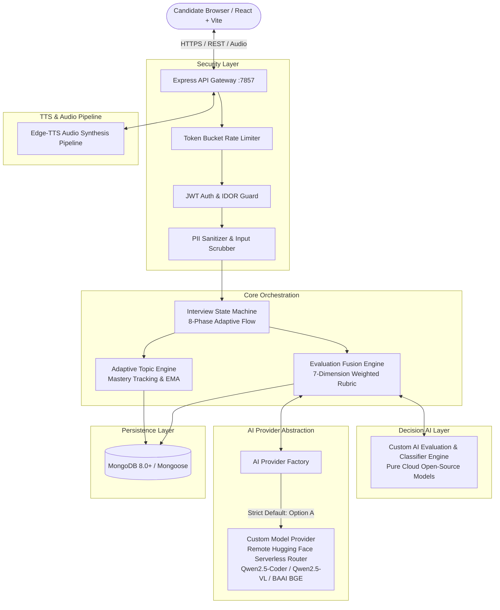

# PrepAI — Enterprise-Grade AI-Powered Placement Preparation Platform

[](#testing--quality-verification)
[](#testing--quality-verification)
[-blue.svg)](BENCHMARKS.md)
[](#model-providers)
[](LICENSE)

PrepAI is a privacy-first technical interview and placement preparation platform for engineering students. It runs with **Custom Models by default** for instant live cloud/VPS publishing, supported by four AI layers:
1. **Generative layer**: Custom Models (`CustomModelProvider`) or any OpenAI-compatible live endpoint (vLLM, Groq, LM Studio, custom endpoints). Configurable for live dialogue and analytical grading.
2. **Decision layer**: `convaiinnovations/laya` in a Python microservice (:7860) returns typed decisions with class probabilities (answer state, relevance, completeness, unsupported claims, follow-up need, response state).
3. **Embedding layer**: Custom embeddings or automated 768-dimensional normalized deterministic fallback for semantic similarity to reference answers.
4. **Deterministic layer**: a 7-dimension weighted rubric ($\sum W_i = 1.0$), evidence verification, a conflict policy, a 10-state interview state machine and per-topic mastery with deterministic difficulty rules.

No score is ever invented: if the grading model is unavailable an answer is marked *evaluation failed* and can be retried, instead of receiving a fallback number.

---

## Key System Highlights

- **Custom models & live cloud deployment**: runs on your own custom model server (vLLM, LM Studio, Groq, or custom endpoints) without requiring local desktop software like Ollama. PII (emails, phone numbers, LinkedIn URLs) is scrubbed before any prompt.
- **Provider abstraction**: swappable generation providers (Custom, OpenAI-compatible, Anthropic, Gemini, or Ollama) with retries, an explicitly configured fallback provider and per-call observability (`model_executions`: latency, retries, fallback, structured-output validity).
- **Multi-signal evaluation (eval-v4)**: LLM rubric evaluation + Laya decisions, with embedding similarity recorded as supporting evidence. Evidence quotes must appear verbatim in the student's answer; concepts claimed without evidence become *UNVERIFIED*; disagreements between signals are recorded and resolved by evidence or flagged *review required*.
- **7-dimension rubric**: Correctness 25 %, Relevance 15 %, Technical Depth 15 %, Completeness 15 %, Reasoning 10 %, Clarity 10 %, Communication 10 %, aggregated deterministically in code. Caps can only lower a score (e.g. an INCORRECT answer cannot score above 40 on correctness).
- **10-state interviewer**: Introduction → Background → Resume → Technical Basics → Technical Depth → Problem Solving → Scenario → Behavioral/HR → Final → Feedback, with counter-question strategies (clarification, correction, depth, challenge) chosen in code from Laya signals, duplicate-question suppression and prompt-markup sanitising.
- **Interview memory (RAG)**: every finished interview is indexed per answer with `nomic-embed-text` embeddings (`interviewmemories`). Later interviews retrieve the most relevant history for the current topic, so the interviewer revisits concepts you missed before, avoids repeating questions and welcomes you back with your weakest area. View or clear it with `GET` / `DELETE /api/v1/memory`; backfill old interviews with `node server/scripts/backfill_interview_memory.js`.
- **Improvement analysis**: every report shows the gap to the placement-ready score (70), the points each dimension would add, the fastest path to the target, the topics and concepts to learn (flagging ones missed in earlier interviews) and progress versus previous interviews, with a written analysis grounded in those numbers.
- **Adaptive mastery**: per-topic recency-weighted, smoothed mastery in five bands (Beginner → Advanced) with Easy/Medium/Hard transitions that need stable evidence (no oscillation on one lucky answer).
- **Deterministic aptitude engine**: server-side timing, numeric tolerance, per-question attempts, per-topic mastery, adaptive selection and versioned questions with balanced answer positions.
- **Verified resume analysis**: PyMuPDF text extraction, structured extraction checked against the source text (nothing that is not in the resume is reported), six ATS dimensions and interview hot spots.
- **Security**: 15-minute access tokens with rotating refresh tokens and logout revocation, CORS allowlist, request ids, security headers, rate limits, ownership checks on every resource, audit log, anonymised leaderboard.
- **Measured, not claimed**: on the 120-case benchmark the grading pipeline reaches 85.8 % hiring-decision accuracy with **0 % false positives** (no failing answer passed). See [BENCHMARKS.md](BENCHMARKS.md) for every metric, including the weak ones.

---

## High-Level Architecture Flow



---

## Repository Structure

```
Mini project/
├── frontend/                     # React 18 + TypeScript + Vite + Tailwind UI
│   ├── src/
│   │   ├── components/           # Reusable UI components & layouts
│   │   ├── pages/                # Interview, Report, Aptitude, Resume, Dashboard
│   │   ├── types/                # TypeScript interfaces (report.ts, interview.ts)
│   │   └── api/                  # Axios HTTP client configuration
│   └── package.json
├── server/                       # Node.js + Express + MongoDB Backend
│   ├── src/
│   │   ├── config/               # Database and environment initialization
│   │   ├── evals/                # 120-test golden benchmark & multi-model harness
│   │   │   ├── benchmarkDataset100.json
│   │   │   ├── runFullBenchmark.js
│   │   │   └── compareModelProviders.js
│   │   ├── middleware/           # Rate limiter, auth, PII scrubbing, error handler
│   │   ├── models/               # User, Interview, TopicMastery, Report, Aptitude
│   │   ├── routes/               # REST API endpoints (auth, interview, report, etc.)
│   │   ├── services/             # Core engines & abstraction layer
│   │   │   ├── providers/        # AIProvider, Ollama, Anthropic, Gemini, OpenAI, Factory
│   │   │   ├── adaptiveEngine.js         # Topic mastery & difficulty progression
│   │   │   ├── aiService.js              # High-level AI coordination
│   │   │   ├── evaluationEngine.js       # 7-dimension rubric evaluator & Laya fusion
│   │   │   ├── interviewStateMachine.js  # 10-state interview machine & counter-question strategies
│   │   │   ├── layaClient.js             # HTTP client for Laya decision microservice
│   │   │   └── semanticEngine.js         # Cosine similarity & vector math
│   │   └── tests/                # Native Node.js unit & integration tests
│   │       └── prepai.test.js
│   └── package.json
├── scripts/                      # Orchestration & test scripts
├── package.json                  # Workspace management scripts
└── README.md                     # Project documentation
```

---

## Quickstart & Installation

### 1. Prerequisites
- **Node.js** 20+ (developed on Node 26)
- **MongoDB** 6+ running locally or MongoDB Atlas in the cloud
- **Hugging Face Account / Token**: From [huggingface.co/settings/tokens](https://huggingface.co/settings/tokens) (Free tier supported)

### 2. Configure Custom Models (Option A: 100% Hugging Face, No Locals)
Set your custom model parameters in `server/.env`:
```env
AI_PROVIDER=custom
CUSTOM_MODEL_URL=https://router.huggingface.co/hf-inference/v1
CUSTOM_API_KEY=your_huggingface_token_here          # or set HF_TOKEN=
HF_TOKEN=your_huggingface_token_here

# Specific open-source models for each interview task:
CUSTOM_MODEL=Qwen/Qwen2.5-Coder-7B-Instruct
CUSTOM_EVALUATION_MODEL=Qwen/Qwen2.5-Coder-7B-Instruct
CUSTOM_VISION_MODEL=Qwen/Qwen2.5-VL-7B-Instruct
CUSTOM_EMBEDDING_MODEL=BAAI/bge-small-en-v1.5

# No local microservices required:
LAYA_ENABLED=false
```

### 3. Install dependencies
```bash
npm --prefix server install
npm --prefix frontend install
```

### 4. Configure the API
```bash
cp server/.env.example server/.env   # then set JWT_SECRET and HF_TOKEN
```
[`server/.env.example`](server/.env.example) lists every variable the code reads. The important ones:

| Variable | Default | Purpose |
|---|---|---|
| `MONGODB_URI` | `mongodb://127.0.0.1:27017/prepai` | Database |
| `JWT_SECRET` | — | **Required** in production (the API refuses to start with the dev key) |
| `JWT_ACCESS_TTL_MINUTES` / `JWT_REFRESH_TTL_DAYS` | `15` / `30` | Access / refresh token lifetime |
| `CORS_ORIGINS` | `http://localhost:5174,…` | Allowed browser origins |
| `AI_PROVIDER` | `custom` | 100% Custom / Hugging Face models |
| `CUSTOM_MODEL_URL` | `https://router.huggingface.co/hf-inference/v1` | Remote custom inference API endpoint |
| `CUSTOM_MODEL` | `Qwen/Qwen2.5-Coder-7B-Instruct` | Live interviewer dialogue model |
| `CUSTOM_EVALUATION_MODEL` | `Qwen/Qwen2.5-Coder-7B-Instruct` | Grading, reference packs, report prose |
| `CUSTOM_VISION_MODEL` | `Qwen/Qwen2.5-VL-7B-Instruct` | Camera proctoring & webcam frame analysis |
| `CUSTOM_EMBEDDING_MODEL` | `BAAI/bge-small-en-v1.5` | Semantic vector embeddings & scoring |
| `LAYA_ENABLED` | `false` | Disabled (pure custom cloud models, zero local daemons) |

### 5. Prepare the database
```bash
npm --prefix server run seed       # question bank and the placement-officer account (never deletes data)
npm --prefix server run migrate    # idempotent schema/data migration to the v4 engine
node server/scripts/balance_option_positions.js   # spread correct answers over A–D (idempotent)
```
There are no demo students: students create their own accounts. The placement-officer login is `admin@prep.ai` /
`admin123`. Change it before any shared deployment.

### 6. Run the application
One command starts everything (and is safe to run again — anything already running is left alone):
```bash
npm run dev            # same as: npm run start:all
```
It starts the AI service verification, the Laya service, the API and the web app in order, waits until each one is healthy,
verifies that the AI models configured in `server/.env` are reachable, and prints a ✔/✘ summary. Open
http://localhost:5174 when it says "Everything is running". Ctrl+C stops what it started.

To run a single part instead: `npm run laya:start`, `npm run dev:server`, `npm run dev:web`.
If your AI model server is unreachable, the app provides clean diagnostic status,
instead of failing on your first answer.
`GET /api/v1/health` reports the API and database status; signed-in staff can check the models,
embeddings and Laya at `GET /api/v1/internal/ai/health` and see per-feature latency at
`GET /api/v1/internal/ai/metrics`.

---

## Testing & Quality Verification

| Suite | Command | Result (2026-10-07) |
|---|---|---|
| Server unit tests (evaluation, mastery, state machine, aptitude, resume, benchmark metrics, security helpers, job deferral) | `npm run test:server` | 39 / 39 passing |
| API integration (needs MongoDB, API, Laya and AI models running) | `npm run test:integration` | 14 / 14 passing (~4 min) |
| Laya service | `npm run test:laya` | 7 / 7 passing |
| Frontend unit tests (Vitest) | `npm run test:frontend` | 17 / 17 passing |
| End-to-end (Playwright; app must be running) | `npm run test:e2e` | 9 / 9 passing |
| Type check + lint + production build | `npm --prefix frontend run build` and `npm run lint:frontend` | clean |

The integration suite creates its own `itest_*` accounts and deletes everything they own afterwards.

### Evaluation benchmark (120 cases)
```bash
npm --prefix server run benchmark                                   # configured grading model
npm --prefix server run benchmark:compare -- qwen2.5-coder:7b qwen3:8b
```
Measured results, per-category errors and the reasoning behind the model choice are in
[BENCHMARKS.md](BENCHMARKS.md). Headline (qwen3:8b, fusion): 85.8 % hiring-decision accuracy,
macro-F1 0.816, Pearson r 0.945 with expert scores, **0 % false positives**, MAE 16 points (the
pipeline grades below the experts on wrong answers).

---

## Documentation Index

For deep dives into the platform architecture, algorithms, and operations, refer to the following dedicated manuals:

1. [Architecture Overview](ARCHITECTURE.md) — System topology, 4-layer hybrid AI architecture, component boundaries, and request lifecycle.
2. [Laya Decision Engine](LAYA_INTEGRATION.md) — Non-autoregressive decision modeling with `convaiinnovations/laya`, microservice schemas, and evaluation fusion.
3. [Adaptive Progression Engine](ADAPTIVE_ENGINE.md) — Per-topic Bayesian EMA skill tracking, 5 normalized mastery bands, and difficulty transitions.
4. [120-Scenario Golden Benchmark](BENCHMARKS.md) — Full evaluation report, statistical metrics (MAE, Pearson r, F1), and model comparisons.
5. [AI Architecture & Abstraction](AI_ARCHITECTURE.md) — Provider abstraction layer, prompt engineering, vector embeddings, and fallback mechanics.
6. [Evaluation Engine](EVALUATION_ENGINE.md) — 7-dimension weighted rubric, scoring caps, evidence extraction, and conflict resolution.
7. [Model Providers Guide](MODEL_PROVIDERS.md) — Setting up Ollama, Claude, Gemini, OpenAI, Groq, and vLLM.
8. [Security & Hardening](SECURITY.md) — Token bucket rate limiting, prompt injection defense, PII scrubbing, and IDOR protection.
9. [Database Schema & Migrations](DATABASE.md) — MongoDB collections, schemas, indexes, and performance optimizations.
10. [REST API Reference](API.md) — Complete endpoint reference with payload and response schemas.
11. [Testing & Benchmarking](TESTING.md) — Test suites, quality gates, benchmark methodology, and synthetic test harness.
12. [Deployment & Operations](DEPLOYMENT.md) — Production deployment topologies (Docker, On-Prem, Cloud) and telemetry.
